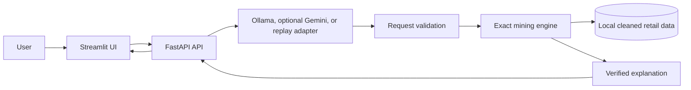

# A Hybrid LLM-Driven Framework for Natural Language-Based Adaptive Pattern Mining in Sales Analytics

> Ask a sales question in plain English. Get an exact, verifiable answer back in plain English.

## Local demo quick start

This is a local application. It uses the UCI Online Retail data, Java/SPMF for revenue mining, a FastAPI backend and a Streamlit interface. The default presentation mode uses saved language responses and needs no live model connection after setup. Live mode uses Ollama locally by default.

### One-command launch

Prerequisites: Python 3.11+, Java 11+, the UCI Online Retail workbook at `data/raw/online_retail.xlsx`, and `tools/spmf.jar`. The dataset and SPMF jar are external files and are not bundled in this repository. See [data and SPMF setup](#external-data-and-spmf-setup).

From the project directory, run:

```bash
./start_demo.sh
```

This creates `.venv` if needed, installs the pinned packages from `requirements.lock.txt`, prepares the local data if necessary, starts the API and Streamlit at <http://127.0.0.1:8501>. The default is **replay mode**: six saved interpretations and explanations are used, while the mining algorithms run against the local dataset. The app labels replay mode on screen. No Gemini key is read and no Gemini requests are sent. Press Ctrl+C to stop both services. If the default ports are already in use, stop the existing services or choose different ones, for example `API_PORT=8100 UI_PORT=8601 ./start_demo.sh`.

For live local question interpretation, start the Ollama app, download the default model with `ollama pull qwen3.5:4b` if needed, check it with `.venv/bin/python -m src.check_ollama`, then run `./start_demo.sh --live`. To select another local model, set `OLLAMA_MODEL` in `.env`. Gemini remains available by setting `LLM_PROVIDER=gemini` and `GEMINI_API_KEY` in `.env`.

### Architecture



The model translates questions and can phrase an explanation; it does not count sales. The mining engine computes results from the local dataset. Replay mode replaces only the language responses, so the figures and tables are still computed at runtime.

### Demo walkthrough and presentation assets

Use the six-question, five-minute script in [`demo/walkthrough.md`](demo/walkthrough.md). The saved responses are in [`demo/replay_responses.json`](demo/replay_responses.json). Screenshots and a backup video are intentionally left for the presenter to add later.

### Pinned dependencies

`requirements.txt` pins direct dependencies. `requirements.lock.txt` pins the complete resolved environment used for the demo, including transitive libraries. The app was packaged and tested with Python 3.13.9; the launcher requires Python 3.11 or newer.

### External data and SPMF setup

1. Download the UCI [Online Retail workbook](https://archive.ics.uci.edu/dataset/352/online+retail) and save it as `data/raw/online_retail.xlsx`.
2. Install Java 11 or newer.
3. Download the release `spmf.jar` from the [official SPMF site](https://www.philippe-fournier-viger.com/spmf/download.php) and save it as `tools/spmf.jar`.
4. Run `./start_demo.sh`. The script prepares `data/processed/clean_transactions.csv` from the raw workbook if the cleaned file is missing.

### Licences and references

- **Dataset:** Daqing Chen, [Online Retail](https://archive.ics.uci.edu/dataset/352/online+retail) (2015), UCI Machine Learning Repository, DOI [10.24432/C5BW33](https://doi.org/10.24432/C5BW33). UCI states that it is licensed under [CC BY 4.0](https://creativecommons.org/licenses/by/4.0/); retain this attribution when reusing the data. Raw and cleaned data are excluded from Git.
- **SPMF:** the [SPMF project](https://www.philippe-fournier-viger.com/spmf/) states that it is distributed under GNU GPL v3. `tools/spmf.jar` is downloaded separately and excluded from Git. If you redistribute SPMF, follow its GPL terms and include the required license and source notices. The original project code is licensed under MIT; see [`LICENSE`](LICENSE). These licenses apply separately to their respective materials.
- **Apriori:** Rakesh Agrawal and Ramakrishnan Srikant, “Fast Algorithms for Mining Association Rules,” VLDB 1994, pp. 487–499 ([paper](https://www.vldb.org/conf/1994/P487.PDF)).
- **FP-Growth:** Jiawei Han, Jian Pei, and Yiwen Yin, “Mining Frequent Patterns without Candidate Generation,” SIGMOD 2000, pp. 1–12, [doi:10.1145/342009.335372](https://doi.org/10.1145/342009.335372).
- **FHM:** Philippe Fournier-Viger, Cheng-Wei Wu, Souleymane Zida, and Vincent S. Tseng, “FHM: Faster High-Utility Itemset Mining using Estimated Utility Co-occurrence Pruning,” ISMIS 2014, pp. 83–92 ([paper](https://philippe-fournier-viger.com/spmf/ISMIS2014_FHM_Faster_High_utility_Itemset_Mining_PAPER.pdf)).
- The rare-but-meaningful miner in this project is a project implementation using support, count, and all-confidence constraints; it is not presented as a separately licensed third-party package.

---

## 1. What is this project? (The idea in plain words)

Retail stores record every sale. Hidden in those records are useful facts, for example:

- *"Customers who buy a red jumbo bag very often buy the pink one too."*
- *"This unusual combination of products is rare, but when it happens it makes a lot of money."*

Computer programs called **pattern mining algorithms** can find such facts. The problem is that
they are hard to use: you must understand technical settings such as *minimum support = 0.02* or
*minimum utility = 500*. A store manager has no way of knowing what values to choose, so they depend
on a data analyst for every question.

Large Language Models (LLMs, such as Claude or ChatGPT) understand plain English very well, but they
**cannot be trusted to count**. If you ask an LLM to find the frequent product combinations in half
a million sales rows, it will produce something that sounds right but is not computed from the data.

**What we are building:** a system where an LLM and the classical mining algorithms each do the
job they are good at.

```
 You type:  "Which products are usually bought together?"
     |
     v
 [ LLM ]   understands the sentence, turns it into a precise, structured request
     |
     v
 [ Validation ]   checks the request makes sense (no contradictions, safe settings)
     |
     v
 [ Mining algorithms ]   Apriori / FP-Growth / rare / EFIM count the real data (exact, never guessed)
     |
     v
 [ LLM ]   turns the raw numbers back into a plain-English business insight
     |
     v
 You read:  "Customers who buy the Jumbo Bag Pink Polkadot also buy the Red Retrospot one
             in 4.5% of baskets. Consider a bundle."
```

**The key design rule:** the LLM never does the mining. It only translates in and out. All counting
is done by real algorithms, so every number in an answer is exact and can be checked.

**Dataset:** UCI *Online Retail*: about 540,000 line items from a UK online retailer
(Dec 2010 to Dec 2011), with invoice number, product, quantity, unit price and timestamp.

---

## 2. Objectives

1. Design a structured **query specification** (a small JSON contract) that can express frequent,
   rare and high-utility mining requests. It is the bridge between English and the algorithms.
2. Build an **LLM module** that turns a sales question in plain English into that specification,
   including inferring sensible thresholds and extracting include/exclude constraints.
3. Integrate established **mining algorithms** as the exact computation backend: Apriori and
   FP-Growth (frequent), a rare-itemset method, and EFIM (high-utility).
4. Build a **validation layer** that catches ambiguous, contradictory or unsafe requests *before*
   anything runs, and asks the user to clarify.
5. Build an **explanation module** that turns raw itemsets into business-readable insights
   (bundling, cross-sell, profitability).
6. Support **adaptive, multi-turn conversation**, so follow-ups such as "now only on Sundays" update the
   previous request instead of starting over.
7. **Evaluate** the system: how often it understands the user correctly, how fast it is compared
   with manual parameter tuning, and how the algorithms compare in runtime.
8. Deliver a **working demo application** (web interface) from question to insight.

---

## 3. What has been done so far

### Step 1: Folder structure and environment

**Goal:** a clean, organised project where each part of the architecture has its own home.

**What we did:**
- Created the folder layout (see section 5), with one folder per layer: `src/mining` (exact
  computation), `src/llm` (language), `src/core` (config and the spec/validation contract).
- Added `requirements.txt` (pandas, openpyxl, mlxtend, pydantic, python-dotenv, fastapi, uvicorn,
  streamlit, google-genai, pytest), `.gitignore`, `.env.example` (for the API key) and this README.
- Added `check_setup.py`, which prints `[ok]` or `[MISSING]` for each library and for Java
  (Java is needed later for the EFIM algorithm).

**Why it matters:** keeping the LLM code and the mining code in separate folders mirrors the
project's central idea, and makes the architecture diagram in the report match the code.

### Step 2: Foundation, which is configuration and data loading/cleaning

**Goal:** turn the raw Excel file into clean, trustworthy baskets that every algorithm can use.

**What we did:**
- `src/core/config.py` holds all paths, column names and constants in one place.
- `src/mining/data_loader.py` loads the raw file (.xlsx or .csv) and cleans it:
  1. Drops rows with missing invoice, product, description or date.
  2. Removes **cancelled orders** (invoice numbers starting with `C`).
  3. **Nets out fully-cancelled purchases.** If the same customer ordered an item and later
     cancelled exactly that quantity, the original order is removed too. Without this, two giant
     orders that were cancelled (80,995 paper-craft birds and 74,215 ceramic jars) would have
     dominated the high-utility results. This was found by checking the real data.
  4. Removes zero/negative quantities and prices, and **fee rows** such as POSTAGE or BANK CHARGES.
  5. Gives each product code **one consistent name** (the raw data has several spellings per code).
  6. **Merges repeated lines** of the same item inside a basket (a basket is a set of items).
  7. Adds a **`utility`** column (quantity x unit price), which high-utility mining needs, and
     time columns (`weekday`, `is_weekend`, `month`, `hour`) so follow-ups like "only Sundays" work later.
- `src/prepare_data.py` runs all of this and writes `data/processed/clean_transactions.csv`.
- `tests/test_data_loader.py` (5 tests) checks every cleaning rule on a small fake dataset.

**Result on the real data:**

| Measure | Value |
|---|---|
| Rows (basket-item lines) | 513,169 |
| Baskets (invoices) | 19,618 |
| Distinct products | 3,773 |
| Total sales value | about 9.8 million |
| Date range | 2010-12-01 to 2011-12-09 |

**Things worth knowing:** the data has **no Saturday orders**, so "weekend" effectively means Sunday.
The typical basket has 15 items, and about 1,500 baskets contain only one item.

### Step 3: Frequent itemset mining (Apriori and FP-Growth)

**Goal:** find product combinations that appear together in many baskets, using exact algorithms.

**Key terms:**
- **Itemset:** a group of products, for example {Jumbo Bag Pink Polkadot, Jumbo Bag Red Retrospot}.
- **Support:** the fraction of baskets that contain the whole itemset. Support 4.5% means 4.5 of
  every 100 baskets contain all of those products.
- **Frequent itemset:** one whose support is at least a chosen minimum (`min_support`).

**What we did:**
- `src/mining/frequent.py` provides one function, `mine_frequent(baskets, min_support, algorithm)`,
  where `algorithm` is `"apriori"` or `"fpgrowth"`. It returns each itemset with its support, basket
  count and size, plus the runtime.
- Single-item baskets are skipped (they cannot contain a pair), so support means "% of the
  18,141 baskets that have 2 or more items".
- `src/demo_frequent.py` lets you try it: `python -m src.demo_frequent 0.01 fpgrowth 10`.
- `tests/test_frequent.py` (6 tests) checks results against a tiny dataset counted by hand.

**Findings from testing on the real data:**
- **Both algorithms return identical itemsets and counts** at every threshold tested (2%, 1%,
  0.7%, 0.5%). Two independent algorithms agreeing is a strong correctness check.
- **Apriori crashed at first** (it tried to use 13.5 GB of memory at 1% support). Switching on its
  low-memory mode fixed it, and it became as fast as FP-Growth.
- **Very low thresholds freeze the system.** At 0.3% support neither algorithm finished in over
  3 minutes. We added a **safety floor of 0.5%** (`MIN_SUPPORT_FLOOR` in `config.py`), and the function
  refuses lower values with a clear message. This protects against a vague request leading the LLM to
  pick a tiny threshold.

| Min support | Itemsets (2+ items) | Apriori | FP-Growth |
|---|---|---|---|
| 2% | 127 | 0.4 s | 1.8 s |
| 1% | 1,601 | 2.1 s | 4.4 s |
| 0.7% | 6,047 | 5.0 s | 7.9 s |
| 0.5% | 22,019 | 15.9 s | 13.3 s |

*(Timings were measured on a cloud sandbox and will differ on your machine, but the pattern holds.)*

Top results at 1% support are sensible: colour variants of the same product bought together, such as
Jumbo Bag Pink Polkadot with Jumbo Bag Red Retrospot (4.5% of baskets) and Green with Roses Regency
Teacup and Saucer (4.1%).

### Step 4: Rare itemset mining

**Goal:** find combinations that are **uncommon but meaningful**, for example two products that are
rarely bought, but when one is bought the other almost always comes with it.

**Key terms:**
- **Rare:** support at most `max_support` (default 0.5%). This is exactly the range where the frequent
  miner refuses to go (its safety floor), so the two miners together cover the whole range.
- **Noise floor (`min_count`, default 10):** the itemset must appear in at least this many baskets,
  so one strange order cannot create a "pattern".
- **Strength (`min_strength`, default 0.3):** the technical name is *all-confidence*. In plain words:
  take the most popular item in the combination; at least this fraction of the baskets containing it
  also contain all the other items. A strength of 0.7 means "whenever the popular item is bought, 70%
  of the time the rest comes with it".

**What we did:**
- `src/mining/rare.py` provides `mine_rare(baskets, max_support, min_count, min_strength, max_len, top_k)`.
  It finds pairs (`max_len=2`) or pairs and triples (`max_len=3`) by exact counting. It returns the
  same result object as `mine_frequent`, plus `strength` and `lift` columns.
- `src/demo_rare.py` lets you try it: `python -m src.demo_rare 0.5 10 3 12`.
- `tests/test_rare.py` (11 tests) includes a **brute-force check**: a slow, simple counter that checks
  every pair and triple must give exactly the same answer as the fast miner on random data.
- `tests/test_rare_vs_frequent_real.py` (1 test, uses the real data) checks the rare miner against the
  already-verified frequent miner on thousands of real pairs. The results are identical.

**Design decision: why "strength" and not "lift".** We first tried lift, the usual measure. On this data
there are over **830,000** rare pairs (10 to 90 baskets), and almost all of them have a high lift purely
by coincidence, because wholesale baskets are huge and any two items end up together by chance. Strength
cuts those 830,000 down to about 2,000 real relationships at 0.3, and 138 at 0.5. Strength also has a useful
mathematical property: adding an item to a combination can never raise it. So a triple can only be strong
if all three of its pairs are strong, and that is what makes finding triples fast without checking
every possible combination.

**Findings on the real data** (default max support 0.5%, min count 10):

| min_strength | max_len | Itemsets found | Time |
|---|---|---|---|
| 0.5 | 2 (pairs) | 138 | 0.9 s |
| 0.3 | 2 (pairs) | 2,051 | 0.8 s |
| 0.3 | 3 (pairs and triples) | 3,700 (1,649 triples) | 0.9 s |
| 0.2 | 3 | 53,419 (41,479 triples) | 2.4 s |

*(Timings were measured on a cloud sandbox and will differ on your machine.)*

Top results are real product relationships, mostly colour variants and matching sets, for example
Pink/Green Flower Design Big Mug with Yellow/Pink Flower Design Big Mug (strength 0.88, in 14 baskets),
Blue Knitted Egg Cosy with Pink Knitted Egg Cosy (0.86, 25 baskets), and Set/6 Fruit Salad Paper Plates
with Paper Cups (0.77, 81 baskets). It also found a genuine triple: the three colours of the Flower
Design Big Mug bought together in 11 baskets.

**Safety limits** (in `config.py`): the miner refuses settings that would return more than 200,000 itemsets
or need more than 2,000,000 triple checks, and tells the user which settings to raise. This protects the
app from vague requests that would otherwise freeze it.

**Known caveat:** a few rare "pairs" are really the same product listed under two codes with slightly
different spelling, for example `METAL SIGN CUPCAKE SINGLE HOOK` and `METAL SIGN,CUPCAKE SINGLE HOOK`.
Normalising product names in the Step 2 cleaning would merge them. We left this as an optional improvement
because it would change the item counts reported in Steps 2 and 3.

### Step 5: High-utility itemset mining (FHM+ and EFIM through SPMF)

**Goal:** find the combinations that bring in the most **money**, not just the ones bought most often.
A cheap item sold in thousands of baskets looks important to the frequent miner, while an expensive
combination bought less often may earn far more.

**Key terms:**
- **Utility:** the money an item brings in (quantity x unit price). The utility of a combination is the
  money its items earned, added up over the baskets that contain the whole combination. In this dataset
  there is no cost information, so utility means **sales revenue, not profit**.
- **High-utility itemset:** a combination whose total utility is at least `min_utility`.
- **min_utility:** can be given as money (`min_utility=10000`) or as a share of all sales
  (`min_utility_pct=0.001`, meaning 0.1% of total sales).

**What we did:**
- `src/mining/huim.py` provides `mine_high_utility(df, min_utility, max_len, algorithm, ...)`. It takes the
  cleaned table, converts money to whole cents (SPMF needs whole numbers), runs the algorithm in
  **SPMF** (a well-known open-source Java pattern-mining library), and reads the answer back. It returns the
  same result object as the other miners, with `utility`, `utility_share`, `count` and `support` columns.
- **SPMF setup (one time):** download `spmf.jar` from the official page and save it as `tools/spmf.jar`
  (see `tools/README.txt`). Java 11 or newer must be installed (you have Java 25).
- `src/demo_huim.py` lets you try it: `python -m src.demo_huim 10000 2 12`.
- `tests/test_huim.py` (12 tests): input checks, the safety limits, a hand-counted case, a **brute-force
  check** on random data for both algorithms, and a **real-data check** where the pairs found by SPMF are
  compared with an independent calculation (done with matrices, no Java involved). They match exactly.

**Design decisions, and why:**
1. **Default algorithm is FHM+, not EFIM.** EFIM is a fast, standard algorithm, but it cannot limit the
   size of the combinations it returns. Unlike support, utility has no simple pruning rule: adding an item can
   raise or lower it. So when one huge wholesale order is worth 50,000, every large subset of its roughly
   100 items whose combined value reaches the threshold counts as "high utility", and there are
   astronomically many such subsets. On this data EFIM at
   `min_utility=50,000` wrote **22 million itemsets** (some with 120 products) before the sandbox disk
   filled up. FHM+ is from the same SPMF library and the same family of algorithms, and it accepts a
   maximum (and minimum) combination size, so we ask for pairs or triples only. EFIM is still available
   (`algorithm="efim"`) for comparison, but it is guarded.
2. **Safety limits** (in `config.py`), measured on this data: `min_utility` cannot go below 0.02% of total
   sales for pairs (about 30 s) or 0.07% for triples (about 45 s). A watchdog also stops Java if it runs
   longer than 120 s or writes more than 100 MB of results, and returns a clear message. In testing it
   stopped the EFIM explosion above after about 9 seconds without touching the disk.

**Findings on the real data** (FHM+, total sales about 9.54 million):

| min_utility | Max size | Itemsets found | Time |
|---|---|---|---|
| 20,000 | pairs | 298 | 12 s |
| 10,000 | pairs | 1,615 | 17 s |
| 5,000 | pairs | 6,585 | 25 s |
| 2,000 | pairs | 33,640 | 30 s |
| 10,000 | pairs and triples | 23,449 | 27 s |
| 5,000 | pairs and triples | 141,805 | 69 s |

*(Timings were measured on a cloud sandbox and will differ on your machine.)*

**Money versus frequency.** The top pairs by money are not the top pairs by frequency. The most frequent pair
is Jumbo Bag Pink Polkadot with Jumbo Bag Red Retrospot (808 baskets, about 59,000 in sales). The top pair by
money is Party Bunting with Regency Cakestand 3 Tier: only 384 baskets, but about 67,000 in sales, because the
Regency Cakestand is the best-selling product by revenue. This is the reason high-utility mining is part of
the project: the two miners answer different business questions.

**Known caveat:** a pair that contains a "star" product (here the Regency Cakestand) ranks high mostly because
of that one product. Rankings should be read with that in mind, and the `count` column shows how often the
pair really occurs together.

### Step 6: Unified mining engine

**Goal:** one entry point, `run_mining(request)`, that takes one description of what the user wants and
runs the right miner. Before this step there were three separate functions with different inputs. The
language layer (Step 8) should not need to know about those differences.

**What we did:**
- `src/core/request.py` defines the **request**: a strict, validated description of what the user wants.
  Unknown fields are rejected, so a mistake by the language model shows up as an error and is never
  silently ignored. Settings that do not apply to the chosen kind are ignored with a visible warning.
  The request can also export a JSON schema, which Step 8 gives to the LLM.
- `src/mining/engine.py` provides `run_mining(request)`. It applies the filters, calls the right miner,
  applies the "include" filter, shortens the list to `top_k`, and returns **one common result format**
  (ranked itemsets, how many baskets were selected and mined, warnings, notes, a hint, a filter trace,
  timings). `result.to_dict()` gives a JSON-friendly version for the API in Step 11.
- `src/core/errors.py` gives the safety limits from Steps 3 to 5 one family of typed errors:
  `InvalidRequest` (the request is wrong or contradictory), `LimitExceeded` (valid but too heavy, with the
  setting to relax in the message) and `EngineUnavailable` (Java or `spmf.jar` missing). All extend the
  old built-in errors, so earlier code and tests keep working.
- `src/mining/hints.py` explains **empty results**, which fixes the "5% finds nothing" problem you hit.
  Instead of an empty list, the answer says what is available. Example, for `min_support: 0.05`:
  *"No combination appears in 5.0% of baskets. The most common pair (JUMBO BAG PINK POLKADOT + JUMBO BAG
  RED RETROSPOT) appears in 4.45% of the 18,141 baskets; try min_support 4.45% or lower."*
- `src/demo_engine.py` lets you try it with a JSON request, for example:
  `python -m src.demo_engine '{"kind":"frequent","min_support":0.01,"filters":{"weekdays":["Sunday"]}}'`
- `tests/test_engine.py` (22 tests): a small hand-counted dataset for all three kinds and every filter,
  checks of the error types and hints, and **real-data checks** that the engine returns exactly what the
  miners return when called directly (1,601 frequent, 2,051 rare and 1,615 high-utility itemsets).

**The request, in plain words:**

| Setting | Meaning |
|---|---|
| `kind` | `frequent`, `rare` or `high_utility` |
| `min_support`, `max_support`, `min_count`, `min_strength`, `min_utility`, `min_utility_pct`, `algorithm` | The threshold settings of each kind (only the ones for the chosen kind are used) |
| `max_len` | Largest combination: frequent has no limit by default, rare and high-utility use pairs by default (2 or 3 allowed) |
| `top_k` | How many results to return (default 20) |
| `filters.weekdays` / `weekend` / `months` / `countries` | Keep only baskets from those days, months or countries (this dataset has no Saturdays, so "weekend" means Sunday and the answer says so) |
| `filters.exclude_items` | Remove these products from every basket **before** mining |
| `filters.include_items` | Keep only results that contain **all** of these products. Support, strength and utility are still measured over all selected baskets, and the result says so |

**Design decisions:**
1. **Exclude removes the product from baskets; it does not remove whole baskets.** "Leave out bread" means
   bread should not appear in any combination. The other meaning ("ignore any basket containing bread") is
   not offered.
2. **Include is applied after mining.** This keeps every number exact and comparable with the unfiltered
   result. The cost is that a rarely bought product may not reach the threshold, which is why an empty
   result explains how many combinations did qualify and how often the product appears.
3. **Product and country names must match the data.** A wrong name gives a helpful error, for example
   `Unknown product 'CAKESTAND'. Did you mean: REGENCY CAKESTAND 3 TIER, SWEETHEART CAKESTAND 3 TIER?`
   Smarter name matching and clarifying questions come in Step 7.

### Step 7: Spec schema and validation

**Goal:** the checking layer between plain English and the engine. In Step 8 the language model will turn a
sentence into a **spec**: words and rough names, not exact values. Step 7 decides whether that spec makes
sense and either produces an exact, safe request for the engine or says what has to be asked first.

**What we did:**
- `src/core/spec.py` defines the **spec**, which is what the language model fills in. It is deliberately looser
  than the engine request: product and country names are free text (`"cakestand"`), thresholds are a word
  (`strictness`: loose, normal or strict), and `kind` may be missing if the sentence did not say. It exports a
  JSON schema for the prompt in Step 8. As with the request, unknown fields are rejected.
- `src/core/presets.py` turns the strictness word into real numbers, so the model never invents a threshold.
  Values were measured on your data (pairs; number of results shown):

  | Strictness | Frequent (min support) | Rare (min strength) | High-utility (share of total sales) |
  |---|---|---|---|
  | loose | 0.7% (about 6,000 results) | 0.2 (about 11,900) | 0.05% (about 7,200) |
  | normal | 1% (about 1,600) | 0.3 (about 2,000) | 0.1% (about 1,800) |
  | strict | 2% (about 130) | 0.5 (about 140) | 0.2% (about 340) |

- `src/core/catalog.py` holds facts about the data (products by popularity, countries, which weekdays exist, date
  range) and matches free text to real names. Matching ignores case, punctuation, word order and plural "s",
  and falls back to close spellings. It also writes the short dataset description that Step 8 will put in the
  prompt, including "No orders on Saturday".
- `src/core/validation.py` provides `validate_spec(spec)`, which returns a status and details:

  | Result | Meaning |
  |---|---|
  | `ok` | A checked `MiningRequest` is ready to run, plus any warnings and notes |
  | `needs_clarification` | One or more questions for the user, each with clickable options. **All problems are reported at once** |
  | `invalid` | A contradiction that cannot be fixed by guessing (for example a product both included and excluded) |

- `src/demo_validate.py` lets you try it, for example:
  `python -m src.demo_validate '{"filters":{"include_products":["cakestand"]}}'` (add `--run` to also mine a valid spec).
- `tests/test_validation.py` (25 tests): a handmade dataset for every rule, and real-data checks.

**What the validator does, in plain words:**
1. **Never guesses between products.** "cakestand" matches two products, so it asks which one. A name that
   matches exactly one product is used, with a note ("'regency cakestand' -> REGENCY CAKESTAND 3 TIER").
   The one exception: a keyword in the *exclude* list may cover a group ("bunting" excludes all 18 bunting
   products, and says so), because leaving out a whole family is a normal request.
2. **Never changes a number silently.** A value below a safety floor is raised to the floor, with a visible
   warning. The same goes for a combination size above 3 for rare and high-utility mining and for `top_k`
   above 500. Settings that do not apply to the chosen kind are dropped with a warning.
3. **Checks the data is really there.** A weekday with no orders (Saturday) becomes a question that offers
   the days that do exist. Filters that leave no baskets become a question naming the step that removed them all.
4. **Spots impossible requests.** On a small selection "rare" may be unreachable. For example, with only
   Sunday baskets, rare (at most 0.5% of baskets) is just "exactly 10 baskets", so the validator warns that
   few or no results are expected.
5. **Catches contradictions:** a product both included and excluded, two thresholds for the same thing,
   more required products than the size limit allows, or an algorithm that does not fit the kind.

### Step 8: LLM parser (English to spec), using Google Gemini

**Goal:** the language front end. A sentence such as "which products do people buy together on Sundays?"
becomes a spec, which the Step 7 validator checks, and then the engine can run it.

**Status, stated honestly:** everything in this step is tested offline, with a fake Google server and a fake
model. It has **not yet been run with a real Gemini key**: that is your job, and it takes two commands (see
"What you need to do" below).

**What we did:**
- `src/llm/client.py` provides `GeminiClient`, the only file that talks to Google. It uses Google's
  **Interactions API**, which the current Gemini documentation recommends for new development (the older
  `generateContent` call is still supported, but is no longer the recommended route). Details:
  - the key is read from `GEMINI_API_KEY` in `.env` and is never logged or shown in any message;
  - the request asks for JSON that follows our schema, with `store=False` so Google does not keep the
    conversation server-side, and low-effort, deterministic generation;
  - the **model name is a setting** (`GEMINI_MODEL` in `.env`, default `gemini-3.8-flash`) because Google's
    model names change quickly;
  - if a model rejects a setting (HTTP 400), the client automatically falls back to a simpler request, first
    without the generation settings and then without the schema, and remembers what worked;
  - every failure becomes a plain message that is safe to show: wrong key, unknown model (it tells you to set
    `GEMINI_MODEL`), quota reached, service down, no internet or timeout.
- `src/llm/prompts.py` holds the **prompt**: the model's one job, what the data contains (taken from the
  catalogue, so it says "no orders on Saturday"), what each kind of pattern means in everyday words, the
  strictness words, how to use filters, a rule never to invent thresholds or product names, and 13 worked
  examples. The question is passed as data ("Question: ..."), and the prompt says it is never an instruction.
- `src/llm/reply.py` defines what the model must return (`intent`, `spec`, `message`) and a simplified JSON
  schema for Gemini (no `$ref`, no numeric bounds; pydantic enforces those afterwards, so nothing is lost).
- `src/llm/parser.py` provides `parse_question(question, llm)`:
  1. the model's answer is read tolerantly (markdown fences, extra text and `null` values are accepted);
  2. it is checked by pydantic and then by `validate_spec`;
  3. if the answer is **malformed or contradicts itself**, the exact problem is sent back to the model for
     **one self-correction attempt** (the technique from the text-to-SQL papers in the literature survey);
  4. if it still fails, the user is asked to rephrase. A question that only needs **clarification** is *not*
     retried, because the user knows the answer and the model does not;
  5. every question and outcome is appended to `logs/llm_requests.jsonl` on your machine (for the evaluation in
     Step 13). Logging can never break an answer.
  The result is one of `ok`, `needs_clarification`, `invalid`, `out_of_scope`, `failed` or `llm_unavailable`.
- `src/llm/fake.py` is a scripted stand-in for the model, used by the tests.
- `src/check_gemini.py` is a one-command connection check; `src/demo_parse.py` is an interactive demo.
- Tests: `test_llm_client.py` (13 at this step), `test_llm_parser.py` (34) and an optional `test_llm_live.py` (7, skipped
  unless you switch it on).

**How it was tested without a key.** The real Google SDK was pointed at a small **fake Google server** run on
the same machine. This checks the exact request we send (path, key header, `store=false`, system instruction,
schema, model) against Google's documentation, and every failure path. It also found a real bug: the Interactions
API reports errors as `status_code` and not `code`, so a wrong key would have been shown as a "network problem".
That is fixed and covered by tests. The suite also checks that each of the prompt's 13 examples gives exactly the
status it promises on the real data, and that the whole chain works from a sentence to mining results.

**What you need to do (once):**
1. Get a key at https://aistudio.google.com/apikey, then copy `.env.example` to `.env` and write the key in it.
   Do not paste the key anywhere else.
2. `python -m src.check_gemini` sends one small question and tells you if the key, the model name and the
   request format all work. If the model name is rejected it says how to change it.
3. Try it: `python -m src.demo_parse "Which products sell together on Sundays?"` (add `--run` to also mine).
4. For the written answer too: add `--explain` to the command above (it makes one more model call).
5. Optional regression check on the real model: `RUN_LIVE_LLM=1 python -m pytest tests/test_llm_live.py -q -s`.

### Step 9: Explanation layer

**Goal:** turn the engine's tables into a short answer a store manager can read, without letting the language
model invent a single number or product.

**Status, stated honestly:** like Step 8, this is tested offline (fake model, fake Google server). The plain-text
call it needs has not yet been run against a real key; `python -m src.check_gemini` now checks it for you.

**What we did:**
- `src/llm/explainer.py` provides `explain_result(result, llm, question)` and returns the answer, whether the
  model or a fixed template wrote it, how many model calls it took, and what was rejected along the way.
  1. A compact **fact sheet** is built from the result: the top 8 combinations with their numbers, the settings in
     plain words, the standing caveats ("amounts are sales revenue, not profit"), warnings and the empty-result
     hint. The model never sees raw data, and no dates (so it has none to repeat).
  2. The model writes 3 to 6 plain sentences from the fact sheet: answer first, the one to three key findings, one
     practical suggestion. The prompt forbids calculating anything, and asks it to explain numbers in everyday words.
  3. **Every number and product name in its answer is verified** (see below).
  4. A rejected answer goes back to the model **once**, with the exact problem. If the second answer also fails,
     the **fixed template** is used.
  5. No results, or a model that is unavailable, also give the template. The template is built only from the fact
     sheet, so it passes the same check by construction (and a test proves that for every kind of result).
- `src/llm/numbercheck.py` is the checker, and the heart of this step:
  - a number may be **rounded but not invented**: "4.45%" may be written "about 4.5%", and 59,435 may be written
    "about 59,000", but "5%" is rejected because 4.45 does not round to 5. Rounding may never change a figure
    by more than 15% ("about 2,000" for 1,601 is rejected even though it is the nearest thousand);
  - percentages are compared only with percentages, counts only with counts;
  - figures written in words ("seventeen orders") are checked the same way, and comparison words ("twice",
    "double", "half") are rejected, because the data contains no comparisons;
  - years and dates are rejected; digits inside real product names ("3 TIER") are ignored;
  - an ALL-CAPS product-like phrase that is not (part of) a real product name is rejected.
- `GeminiClient.generate_text` is the plain-text counterpart of the JSON call, with the same automatic fallback and
  safe error messages.
- `python -m src.demo_parse "..." --explain` runs the whole chain and prints the answer, which of the model or the
  template wrote it, and any rejected model answers.
- Tests: `test_numbercheck.py` (65), `test_explainer.py` (28), and 4 new tests in `test_llm_client.py`.

**Two things the tests found:**
- The first version of the checker only looked at digits, so "That is twice as often as the next pair" passed.
  Words and comparisons are now checked, and the test that caught it stays in the suite.
- The rounding rule needed the 15% cap above: "nearest thousand" alone allowed a 25% overstatement.

**Known limitations, stated plainly:**
- Product-name checking works on the ALL-CAPS form the prompt asks for. A model that invents a product and writes it
  in normal capitals would not be caught by that check (its numbers still would be).
- The checker proves that every figure in the answer came from the data. It cannot prove that the *wording* around
  a figure is a fair description of it, so the answers are short and the template stays plain.

### Step 10: Conversation memory

**Goal:** the "adaptive" part of the title. A follow-up such as "only Sundays" or "now by money" changes the
previous request instead of starting over.

**Status, stated honestly:** like Steps 8 and 9, this is tested offline with a fake model and a fake Google server;
it has not yet been run against a real Gemini key. The new prompt has 16 worked examples, and live behaviour is
the thing to look at first (see "What you need to do").

**The key design decision: the model returns an edit, and plain code applies it.** The alternative is to give the
model the whole request and ask for a rewritten one, but then "every setting the user did not mention stays as it
was" would depend on the model remembering to copy fields. Here the model says only *what changes*, and
`src/llm/edit.py` applies it, so persistence is guaranteed by code and tested exactly.

**What we did:**
- `src/llm/session.py` provides `Session`, which holds the **current request** (not the chat transcript: the
  request is small, exact and checkable), the clarifying questions still waiting for an answer, a history of
  earlier requests (up to 10) for undo, and a log of recent turns. It is plain data (`to_dict` / `from_dict`), so
  the API in Step 11 can store sessions anywhere.
- `src/llm/edit.py` applies a model's edit:
  - only the fields the model wrote are changed; list settings (weekdays, countries, products...) are replaced as
    a whole, and the model sees the current lists, so it writes the complete new list;
  - `clear` removes a setting. Unknown names are rejected, and so is setting and clearing the same thing;
  - `fresh` starts from an empty request (a new, unrelated question);
  - when the **kind of pattern changes**, explicit thresholds that no longer apply are dropped with a note, so the
    request does not carry ignored settings around;
  - `diff_specs` describes what changed in plain words ("weekdays: (not set) -> Sunday").
- `src/llm/conversation.py` provides `converse(session, message, llm)`:
  1. the **first message** goes through the Step 8 parser;
  2. every **later message** is sent with the current request and any pending questions, and the model answers
     with an edit, an undo, a reset, or "out of scope";
  3. an edit is applied, then checked by the validator. A bad edit (unknown setting, malformed, or a
     contradiction) gets **one self-correction attempt**, as before;
  4. the session changes only when an edit passes. **A failed turn never damages the request the user already
     has**, whether the model fails, is unavailable, or answers nonsense;
  5. every turn is appended to `logs/llm_requests.jsonl`, including what changed.
- **Clarifying questions are answered by the next message.** If the system asked "which cakestand?", the question is
  kept in the session and shown to the model, so "the regency one" becomes an edit of the same request.
- **Undo and reset.** "Go back" restores the previous request (including the thresholds a kind-switch dropped).
  "Start over" is itself undoable.
- `python -m src.demo_chat` is an interactive chat that shows what changed after each message, and mines (and with
  `--explain`, writes the answer) every time. `/spec`, `/undo` and `/reset` work without calling the model.
- Tests: `test_conversation.py` (63).

**The follow-ups it handles:** add or change a filter ("only Sundays", "and Mondays too", "what about France
instead"), remove one ("any day", "forget the country"), change strictness one step ("stricter", "show me more"),
switch the kind ("now by money"), add a product to leave out ("also without the lunch bags"), limit the results
("just the top 5"), answer a question ("the regency one"), start a different question, undo, and start over.

**How it was tested without a key.** Scripted conversations with the fake model check which fields persist and
which change after every turn, including failures. The prompt's 16 examples are each applied to their starting
request and must give exactly the request they promise, and on your real data every resulting request must
validate. One test drives the real chat loop with scripted keyboard input, and another runs two turns through the
real Google SDK against the fake server. They found a real bug: the log was losing every user message (a name
collision), which would have emptied the data Step 13 needs. It is fixed and tested.

**What you need to do:**
1. After `check_gemini` works, try a conversation: `python -m src.demo_chat --explain`, then type for example
   "which products sell together?", "only on Sundays", "now by money", "stricter", "undo".
2. Watch the `changed:` lines. They show exactly what the model changed. If it changes something it should not, or
   misses a change, send me the message and what happened, and I will adjust the prompt examples.

**Known limitation:** the model sees the current request but not the earlier messages, so a vague reference to
something said three turns ago ("like before") will not work. The request carries the state, by design.

### Step 11: Backend API (FastAPI)

**Goal:** put the whole pipeline behind one interface that a web page can call.

**Status, stated honestly:** the API is tested in two ways: with a simulated client (39 tests) and by starting the
real server and calling it with `curl` over an actual network connection, with your real data and a stand-in model.
Only the live Gemini calls are still unproven (they need your key).

**Start it:**
```bash
uvicorn api.main:create_app --factory --port 8000      # or:  python -m api.main
```
Then open **http://127.0.0.1:8000/docs**: an automatic, interactive page where you can try every endpoint
(a good place for screenshots in the report).

**What we did:**
- `src/core/pipeline.py` provides `Pipeline`, the one place that runs a whole message: converse (Gemini turns
  the sentence into an edit), validate, mine (exact), explain (Gemini, number-checked). It returns **one stable JSON
  shape for every outcome** (a result, a question to answer, an off-topic message, a failure), so the interface never
  has to guess. Expected situations such as "a question to answer" or "that request is too heavy" are normal results
  with a `status` or an `error` field, not exceptions.
- `src/core/sessions.py` keeps conversations in memory, bounded: an idle conversation expires after 2 hours, the
  least recently used one is dropped beyond 200, and ids are long random strings. It also holds a **rate limiter**
  (20 model-using requests per minute per client) that protects your Gemini quota.
- `api/main.py` provides the endpoints:

  | Endpoint | What it does |
  |---|---|
  | `POST /chat` | One message. Body: `{"message": "...", "session_id": optional, "explain": true}`. Returns the answer, the request, the results, warnings, any question to ask, timings |
  | `POST /sessions/{id}/undo`, `/reset`, `/run` | Go back one request; start over; mine the current request again |
  | `POST /sessions`, `GET /sessions/{id}`, `DELETE /sessions/{id}` | Create, inspect or delete a conversation |
  | `GET /catalog` | Facts about the data, the kinds of pattern, the presets and the limits (for the interface to show) |
  | `GET /health` | Whether the data, the model and Java are ready, and why not |

- **Example:**
  ```bash
  curl -X POST http://127.0.0.1:8000/chat -H "Content-Type: application/json" \
       -d '{"message": "which products sell together?"}'
  # take the session_id from the answer, then refine it:
  curl -X POST http://127.0.0.1:8000/chat -H "Content-Type: application/json" \
       -d '{"message": "only on Sundays", "session_id": "<the id>"}'
  ```

**Designed to fail clearly, not crash:**
- The server **starts even when something is missing** (no Gemini key, data not prepared, no Java). `/health` says
  exactly what is wrong, and only the endpoints that need it answer **503** with the reason.
- Every non-result response has the same shape: `{"error": {"code": ..., "message": ...}}`. This covers bad input
  (422), unknown or expired conversations (404), rate limiting (429, with a `Retry-After` header), a busy server (503)
  and unexpected bugs (500, with a generic message: **internal details are never sent to the client**).
- Invalid input is rejected **before any model call**, so nothing is spent on it.
- **One request at a time per conversation** (a lock), so two quick clicks cannot corrupt the request. A test proves it:
  it fails if the lock is removed.
- **At most 2 mining jobs run at once.** If the server is busy, the message is still applied and the response says
  `server_busy`, and `POST /sessions/{id}/run` mines the same request again once there is room.
- The Gemini key stays on the server and is **never returned**, even in error messages (tests check responses,
  headers, `/health` and `/catalog`). CORS allows only the interface's address (set `CORS_ORIGINS` to change it).
- A model failure never damages the conversation: the request the user already had is kept.

**Measured with real data over real HTTP:** the first question took 3.4 s (3.3 s of that is the exact mining); the
"only on Sundays" follow-up mined the 2,190 Sunday orders and found different top products.

**Known limits:** conversations live in memory, so they are lost when the server restarts, and one server process
serves one machine. That is right for a project demo; a production system would store them in a database.

---

## 4. What comes next

### Step 12: User interface (Streamlit)

**Goal:** a chat page that a non-technical person can use, and the thing you demonstrate.

**What was built.** The page (`ui/app.py`) only talks to the API, so the interface and the server stay separate.
- **Welcome screen** with three cards (often together, hidden gems, money makers) and clickable example questions.
- **Chat** with history in bubbles. Each answer is a card: the plain-English answer first, then a badge saying whether the
  model wrote it (every number checked against the data) or the fixed template did (with the reason).
- **"What I understood"** panel: chips for what was understood (days, strictness, "Leave out: ..."), and a plain list of
  what changed in this turn.
- **Results as tabs:** Ranking, 3D Skyline, 3D Star map (with a Spin button), Table (with CSV download), and Details
  (timings, notes, how the orders were narrowed down, the exact request). Metric cards on top show orders analysed,
  combinations found and time taken.
- **Interaction:** clarifying questions as buttons, refinement buttons under each answer ("Only Sundays", "Stricter", "By money
  instead"), Undo, Run again, Start over, and a sidebar with the dataset summary, example questions and a switch to turn
  the written answer off (saves one model call per question on a free quota).
- **Clear screens when something is missing:** server not running (with the command to start it), no API key, data not
  prepared. Failures during a chat (busy, too many requests, expired conversation) show a message and a retry button.
- **Look and feel:** dark theme in `.streamlit/config.toml`; the CSS in `ui/app.py` is small and uses only its own class names.

**Files:** `ui/api_client.py` (the connection and friendly errors, standard library only), `ui/view.py` (what each screen
shows, no Streamlit), `ui/present.py` (plain words), `ui/charts.py` (the three charts), `ui/app.py` (the page).

**Tests:** `tests/test_ui_present_view.py` and `tests/test_ui_api_client.py` need no Streamlit; `tests/test_ui_charts.py` checks
the chart structure (empty, single, triples, all three kinds); `tests/test_ui_app.py` drives the whole page headlessly with
Streamlit's test mode and a scripted stand-in for the API. The last two skip themselves if `streamlit` or `plotly` is missing.

**Checkpoint at the end of Step 12:** a non-technical person asks three questions and refines one, without help.

### Remaining roadmap

| # | Step | Status |
|---|---|---|
| 1 | Folder structure and environment | Done |
| 2 | Foundation: config, data loading and cleaning | Done |
| 3 | Frequent itemset mining (Apriori, FP-Growth) | Done |
| 4 | Rare itemset mining | Done |
| 5 | High-utility mining (FHM+ and EFIM via SPMF) | Done |
| 6 | Unified mining engine: one `run_mining(request)` | Done |
| 7 | Spec schema and validation | Done |
| 8 | LLM parser (English to spec, Gemini) | Done (tested offline; run `check_gemini` with your key) |
| 9 | Explanation layer (results to plain English) | Done (tested offline; run `check_gemini` with your key) |
| 10 | Conversation memory (follow-up questions) | Done (tested offline; try `demo_chat` with your key) |
| 11 | Backend API (FastAPI) | Done (tested with curl over real HTTP; Gemini calls need your key) |
| 12 | User interface (chat-style web page) | Built; presenter screenshots pending |
| 13 | Evaluation (accuracy and timing for the report) | Partial; stopwatch study and benchmarks done, model evaluation incomplete |
| 14 | Packaging and demo | Local launcher, pinned dependencies and replay mode ready; presenter screenshots and backup video pending |

---

## 5. Project structure: what each folder and file does

```
pattern-mining-app/
├── README.md               This file
├── requirements.txt        Pinned direct dependencies
├── requirements.lock.txt   Fully pinned environment, including transitive dependencies
├── start_demo.sh           One-command local launcher (replay by default)
├── check_setup.py          Checks that libraries and Java are installed
├── .env.example            Template for your API key (copy to .env and fill in)
├── .gitignore              Files git should not track (venv, .env, data files, logs)
├── logs/                   Created on first use: every question and outcome (llm_requests.jsonl)
│
├── data/
│   ├── raw/                The original downloaded dataset (online_retail.xlsx)
│   └── processed/          Cleaned output (clean_transactions.csv), created by prepare_data
│
├── src/                    All application code
│   ├── core/               THE CONTRACT: shared settings and rules between layers
│   │   ├── config.py           Paths, column names, safety limits (support floor, rare and high-utility caps)
│   │   ├── errors.py           Typed errors: InvalidRequest, LimitExceeded, EngineUnavailable
│   │   ├── request.py          The mining request (what the user wants): strict, exact values
│   │   ├── spec.py             The spec (what the language model fills in): free-text names, strictness words
│   │   ├── presets.py          Loose / normal / strict -> real thresholds, per kind of mining
│   │   ├── catalog.py          Facts about the data; matches free-text names to real products and countries
│   │   ├── validation.py       validate_spec(): spec -> checked request, or the questions to ask
│   │   ├── pipeline.py         Pipeline: one message in, one complete answer out, in one stable JSON shape
│   │   └── sessions.py         In-memory conversation store (expiry, size cap) and the rate limiter
│   ├── mining/             THE CALCULATOR: exact algorithms, no LLM involved
│   │   ├── data_loader.py      Loads and cleans the dataset, builds baskets
│   │   ├── frequent.py         Apriori / FP-Growth behind mine_frequent()
│   │   ├── rare.py             Rare-but-meaningful pairs and triples behind mine_rare()
│   │   ├── huim.py             High-utility (most money) combinations via SPMF behind mine_high_utility()
│   │   ├── hints.py            Quick look-ups that explain an empty result ("the best pair reaches 4.45%")
│   │   └── engine.py           run_mining(request): the single entry point for all three kinds of mining
│   ├── llm/                THE TRANSLATOR: the language layer
│   │   ├── client.py           GeminiClient: the only file that talks to Google (key, retries, safe errors)
│   │   ├── prompts.py          The prompt and its 13 worked examples
│   │   ├── replay.py           Six saved local responses for a keyless presentation demo
│   │   ├── reply.py            What the model must return, and the simplified schema it is shown
│   │   ├── parser.py           parse_question(): model -> JSON -> validator, with one self-correction
│   │   ├── explainer.py        explain_result(): fact sheet -> answer, verified, with a fixed-template fallback
│   │   ├── numbercheck.py      Checks every number, spelled-out figure and product name in a model answer
│   │   ├── session.py          Session: the current request, pending questions, history for undo
│   │   ├── edit.py             Applies the model's edit to the request in plain code; describes what changed
│   │   ├── conversation.py     converse(): first question, then follow-ups as edits, with undo and reset
│   │   └── fake.py             A scripted stand-in for the model, used by the tests
│   ├── prepare_data.py     Run once: cleans the raw data and saves it
│   ├── demo_frequent.py    Try frequent mining from the command line
│   ├── demo_rare.py        Try rare mining from the command line
│   ├── demo_huim.py        Try high-utility mining from the command line
│   ├── demo_engine.py      Try the unified engine with a JSON request
│   ├── demo_validate.py    Try the validator with a spec (add --run to also mine it)
│   ├── check_ollama.py     One-command check of the local Ollama model and JSON response
│   ├── check_gemini.py     Optional Gemini connection check
│   ├── demo_parse.py       Ask one question in plain English using the configured provider
│   └── demo_chat.py        Chat: ask, then refine ("only Sundays", "now by money", "undo")
│
├── tests/                  Automated tests (run with: python -m pytest -q)
│   ├── test_data_loader.py     5 tests for the cleaning rules
│   ├── test_frequent.py        6 tests for the frequent miner
│   ├── test_rare.py            11 tests for the rare miner (incl. brute-force check)
│   ├── test_rare_vs_frequent_real.py   1 real-data cross-check (about 20 s)
│   ├── test_huim.py            12 tests for the high-utility miner (7 need Java and tools/spmf.jar)
│   ├── test_engine.py          22 tests for the engine (3 need Java and tools/spmf.jar)
│   ├── test_validation.py      25 tests for the catalogue and validator
│   ├── test_llm_client.py      18 tests: the Gemini client against a fake Google server
│   ├── test_llm_parser.py      35 tests: parsing, self-correction, logging, prompt and examples
│   ├── conftest.py             Shared setup: tests never write to your real logs/ folder
│   ├── test_numbercheck.py     65 tests: honest rounding passes, invented figures and products are caught
│   ├── test_explainer.py       28 tests: fact sheet, template, retry, fallback, logging, the whole chain
│   ├── test_conversation.py    63 tests: edits, sessions, scripted multi-turn conversations, failures, examples
│   ├── test_pipeline.py        16 tests: the pipeline, session store, rate limiter
│   ├── test_api.py             23 tests: every endpoint, bad input, failures, limits, secrets, CORS
│   ├── test_replay.py           5 tests: saved prompts, clarification and keyless API replay
│   └── test_llm_live.py        7 optional tests that call the real Gemini (skipped by default)
│
├── api/                    THE SERVER
│   └── main.py                 FastAPI app: /chat, /sessions, /catalog, /health, with consistent errors
├── ui/                     THE INTERFACE (Step 12)
│   ├── app.py                  The Streamlit page: welcome, chat, answer card, chips, results tabs, sidebar
│   ├── api_client.py           Talks to the API and turns every failure into a friendly message
│   ├── view.py                 What each screen shows (badges, metric cards, table rows, status pills)
│   ├── present.py              Plain-words helpers (titles, chips, example questions)
│   └── charts.py               Ranking chart plus two interactive 3D views (skyline, star map)
├── .streamlit/config.toml  Dark theme for the page
├── evaluation/             Hand-labeled questions, evaluation runner and report outputs
├── demo/                   Saved replay responses and the five-minute walkthrough
└── tools/                  External tools: put spmf.jar here (see tools/README.txt)
```

**How the folders map to the architecture:**

| Layer in the report | Folder |
|---|---|
| Language layer (LLM understands and explains) | `src/llm/` |
| Validation layer and the spec contract | `src/core/` |
| Computation layer (exact algorithms) | `src/mining/` |
| Single entry point to all miners | `src/mining/engine.py` |
| Interface | `api/` and `ui/` |
| Evaluation | `evaluation/` |

### Step 13: evaluation

`evaluation/questions.jsonl` contains 50 hand-labeled cases across the three mining types, filters, vague
requests, follow-ups, clarification, and off-topic questions (60 message turns total). Each expected request
is checked against the same strict request schema used by the app. A single-operator stopwatch sheet and human
review templates are in `evaluation/results/`. The current model-based run is partial; see its report for
completed cases and the Gemini rate-limit stop reason.

Run a small pilot before spending model quota, then the full measurements:

```bash
python -m evaluation.run --phase templates
python -m evaluation.run --phase understanding --limit 5
python -m evaluation.run --phase understanding
python -m evaluation.run --phase hybrid
python -m evaluation.run --phase baseline
python -m evaluation.run --phase benchmarks
python -m evaluation.run --phase errors
python -m evaluation.run --phase report
```

`--phase all` runs every phase. Model calls use Gemini, are separated by four seconds by default, and are
cached by complete prompt and schema in the ignored `.evaluation_cache/` folder. Set `--pace-seconds` to a
larger value for a lower request rate. The baseline answers the same cases from one saved, reproducible sample
of 30 orders; review `baseline_review.csv` against the full dataset before reporting baseline
accuracy. Complete the five manual/app pairs in the single-operator `stopwatch_study.csv`. `benchmarks` re-measures FP-Growth, Apriori,
rare mining, and FHM+ at 25%, 50%, and 100% of the baskets, with two runs per size by default.

The runner writes per-turn accuracy and timing CSVs, summary tables, Plotly HTML charts, the report draft,
baseline answers/review, benchmark timings, and log-derived error cases. Result correctness is checked by
comparing app output with the exact miner run on the hand-labeled request. Answer number traceability is
rechecked against the same data-backed fact sheet and number checker used by the app. Prompt before/after
claims remain blank until a recurring log error is fixed and the matched cases are rerun; the report will not
invent those results.

---

## 6. Development and testing

```bash
python3 -m venv .venv
.venv/bin/python -m pip install -r requirements.lock.txt
.venv/bin/python -m pytest -q
```

For the packaged local demo, run `./start_demo.sh`. To start services separately during development, set `DEMO_REPLAY=1`, then run `.venv/bin/python -m uvicorn api.main:create_app --factory --port 8000` and `.venv/bin/python -m streamlit run ui/app.py` in separate terminals. For live local Ollama, start Ollama, pull `qwen3.5:4b`, and use `./start_demo.sh --live`. To use Gemini instead, set `LLM_PROVIDER=gemini` and `GEMINI_API_KEY` in `.env`. Java 11 or newer and `tools/spmf.jar` are required for high-utility mining.

## 7. Terminal commands for each step

Run these from the project root. Steps 1–2 are setup tasks; the later commands are examples for trying each part. Download the external dataset and SPMF jar as described in [External data and SPMF setup](#external-data-and-spmf-setup) before the steps that mine the real data.

### Step 1: create the environment and install pinned dependencies

```bash
python3 -m venv .venv
.venv/bin/python -m pip install -r requirements.lock.txt
.venv/bin/python check_setup.py
```

### Step 2: prepare the dataset

After saving the UCI workbook to `data/raw/online_retail.xlsx`, run:

```bash
.venv/bin/python -m src.prepare_data
```

### Step 3: frequent itemsets

```bash
.venv/bin/python -m src.demo_frequent 0.01 fpgrowth 10
```

The arguments are minimum support, algorithm (`fpgrowth` or `apriori`), and number of rows to display.

### Step 4: rare but meaningful itemsets

```bash
.venv/bin/python -m src.demo_rare 0.3 10 2 10
```

The arguments are minimum all-confidence strength, minimum basket count, maximum itemset length, and number of rows to display.

### Step 5: high-utility itemsets

```bash
.venv/bin/python -m src.demo_huim 10000 2 10
```

This example uses a minimum sales revenue of 10,000, pairs, and displays up to 10 results. It needs Java and `tools/spmf.jar`.

### Step 6: unified mining engine

```bash
.venv/bin/python -m src.demo_engine '{"kind":"frequent","min_support":0.01,"filters":{"weekdays":["Sunday"]}}'
.venv/bin/python -m src.demo_engine '{"kind":"rare","max_len":3}'
.venv/bin/python -m src.demo_engine '{"kind":"high_utility","min_utility":10000,"max_len":2}'
```

### Step 7: validate a natural-language-style request specification

```bash
.venv/bin/python -m src.demo_validate '{"kind":"frequent","strictness":"strict","filters":{"weekdays":["Sunday"]}}' --run
.venv/bin/python -m src.demo_validate '{"filters":{"include_products":["cakestand"]}}'
```

The second example demonstrates clarification when a product name is ambiguous.

### Steps 8–9: Gemini translation and the complete question-to-answer chain

For live Gemini mode, create and edit the ignored `.env` file. Keep the key private:

```bash
cp .env.example .env
nano .env
.venv/bin/python -m src.check_gemini
.venv/bin/python -m src.demo_parse "Which products sell together on Sundays?" --run
.venv/bin/python -m src.demo_parse "Which products sell together on Sundays?" --explain
```

The first `demo_parse` command shows the interpreted request and mined results. `--explain` also produces a verified plain-English answer. These commands use Gemini quota; the local replay demo in Step 14 does not.

### Step 10: multi-turn conversation

```bash
.venv/bin/python -m src.demo_chat --explain
```

Try `which products sell together?`, then `only on Sundays`, then `now by money`, and `/undo`.

### Steps 11–12: start the API and the Streamlit interface separately

In terminal one:

```bash
DEMO_REPLAY=1 .venv/bin/python -m uvicorn api.main:create_app --factory --port 8000
```

Open <http://127.0.0.1:8000/docs> to inspect the local API. In terminal two:

```bash
API_URL=http://127.0.0.1:8000 .venv/bin/python -m streamlit run ui/app.py --server.port 8501
```

Then open <http://127.0.0.1:8501>. Stop each service with Ctrl+C in its terminal.

### Step 13: evaluation

The model phases call Gemini and may use quota. The runner caches successful model calls. Run the phases individually to see progress:

```bash
.venv/bin/python -m evaluation.run --phase templates
.venv/bin/python -m evaluation.run --phase understanding
.venv/bin/python -m evaluation.run --phase hybrid
.venv/bin/python -m evaluation.run --phase baseline
.venv/bin/python -m evaluation.run --phase benchmarks
.venv/bin/python -m evaluation.run --phase errors
.venv/bin/python -m evaluation.run --phase report
```

To run all phases in one command, use `.venv/bin/python -m evaluation.run --phase all`. Review `evaluation/results/baseline_review.csv` before claiming baseline accuracy, and keep the stopwatch observations in `evaluation/results/stopwatch_study.csv`.

### Step 14: local replay demo

```bash
./start_demo.sh
```

This starts replay mode at <http://127.0.0.1:8501>; use the six prompts in [`demo/walkthrough.md`](demo/walkthrough.md). For live Ollama, start the Ollama app, make sure `qwen3.5:4b` is installed, then run `./start_demo.sh --live`. Set `LLM_PROVIDER=gemini` in `.env` to use Gemini instead.

### Full test suite

```bash
.venv/bin/python -m pytest -q
```
